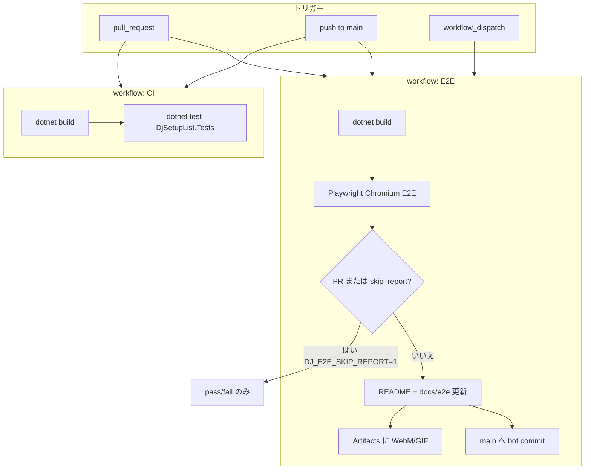

# CI/CD

GitHub Actions で **速い単体 CI** と **重いブラウザ E2E** を分けています。全体像は次のフロー図のとおりです。



## CI（`.github/workflows/ci.yml`）

| 項目 | 内容 |
|------|------|
| いつ | すべての PR、`main` への push |
| やること | `dotnet build` + **単体テストのみ**（`DjSetupList.Tests`） |
| 目的 | テンプレート・Local 音源・CLI・Exporter の regress を早く検知 |

## E2E（`.github/workflows/e2e.yml`）

| 項目 | 内容 |
|------|------|
| いつ | PR、`main` への push、手動実行 |
| やること | Web を起動し Playwright で一連の現場準備シナリオを実行 |
| PR | `DJ_E2E_SKIP_REPORT=1` — **pass/fail だけ**（README / GIF は触らない、ffmpeg 不要） |
| `main` push | 成功時に `docs/e2e` と README の E2E 節を更新し、**[skip ci] で bot commit**（ループ防止） |
| 手動 | `update_readme: false` にすると PR と同様にレポート更新をスキップ |

ローカルでフル実行（README 更新あり）:

```bash
export DJ_LOCAL_LIBRARY="$PWD/sample-library"
dotnet test tests/DjSetupList.E2E/DjSetupList.E2E.csproj
```

PR 相当（レポート更新なし）:

```bash
export DJ_E2E_SKIP_REPORT=1
dotnet test tests/DjSetupList.E2E/DjSetupList.E2E.csproj
```

## フロー図を置く理由

2 本の workflow と「PR では GIF を出さない」分岐があるため、**README か `docs/ci-cd.md` に 1 枚あると**、将来の自分や contributor が「なぜ PR で README が変わらないのか」をすぐ理解できます。図は Mermaid なので GitHub 上でもそのまま表示されます。
